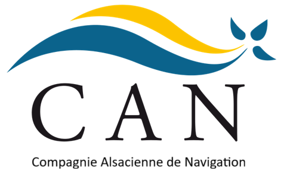

<p align="center">
  
</p>

<h1 align="center">CAN — Compagnie Alsacienne de Navigation</h1>

<p align="center">
  SAE 1.1 · BUT Informatique · IUT Robert Schuman
</p>

---

## Présentation

Ce projet simule le système d'information d'une compagnie de ferries qui dessert deux liaisons en Bretagne :

| ID | Liaison |
|----|---------|
| 1  | Lorient → Groix |
| 2  | Groix → Lorient |
| 3  | Quiberon → Le Palais |
| 4  | Le Palais → Quiberon |

Il se découpe en deux parties :

- **Une application console en C#** pour réserver une traversée et générer la réservation au format JSON.
- **Un site web (HTML / CSS / JavaScript)** côté service après-vente, qui interroge une API REST pour afficher cartes d'embarquement, factures, statistiques et taux de remplissage.

## Fonctionnalités

### Application console (`SAE11.cs`)

- Choix de la liaison, du jour et de l'horaire (sélection de l'heure avec les flèches ↑ ↓)
- Saisie des passagers (nom, prénom, catégorie tarifaire)
- Ajout de véhicules parmi 11 catégories (trottinette, vélo, voiture, camping-car…)
- Réservation d'un trajet retour avec les mêmes passagers et véhicules
- Contrôle des saisies (entiers, oui/non, jours valides, nombres négatifs…)
- Export de la réservation dans `trajet.json`

### Site web

| Page | Rôle |
|------|------|
| `Index.html` | Accueil et navigation |
| `Carte_embarquement.html` | Génère les cartes d'embarquement (passagers et véhicules) avec QR code à partir d'un numéro de réservation |
| `Facture.html` | Affiche la facture détaillée d'une réservation |
| `Statistiques.html` | Chiffre d'affaires, nombre de passagers et de véhicules par liaison |
| `Tableau_Bord.html` | Taux de remplissage (passagers / véhicules) par liaison, jour et horaire, avec code couleur |

## Structure du dépôt

```
.
├── SAE11.cs                  # Application console de réservation
├── SAE11.exe                 # Exécutable compilé
├── trajet.json               # Réservation générée par l'application
├── Index.html                # Accueil
├── Carte_embarquement.html   # + Carte.js
├── Facture.html              # + Facture.js
├── Statistiques.html         # + Stat.js
├── Tableau_Bord.html         # + TableauDeBord.js
├── accueil.css               # Style de la page d'accueil
├── reste.css                 # Style des autres pages
├── CAN.png / port.jpg        # Ressources graphiques
└── SAE11_Rapport.docx        # Rapport du projet
```

## Lancer le projet

### Application console

Sous Windows, il suffit de lancer `SAE11.exe` depuis le dossier du projet.

Pour recompiler à partir des sources :

```bash
csc SAE11.cs
./SAE11.exe
```

> ⚠️ `trajet.json` doit être présent dans le même dossier que l'exécutable. Son contenu est **écrasé** à chaque nouvelle réservation.

### Site web

Aucune installation nécessaire : ouvrir `Index.html` dans un navigateur.
Une connexion Internet est requise, les données étant récupérées depuis l'API.

## API utilisée

Les pages web consomment l'API REST mise à disposition pour la SAE :

```
https://tomorow.eu.pythonanywhere.com/CAN/api
```

| Endpoint | Utilisé par |
|----------|-------------|
| `/reservation/{id}` | Cartes, Facture |
| `/reservation/{id}/passager/{n}` | Cartes, Facture |
| `/reservation/{id}/vehicule/{n}` | Cartes, Facture |
| `/liaison/{id}/chiffreAffaire` | Statistiques |
| `/liaison/{id}/remplissage/{date}` | Tableau de bord |

## Technologies

- **C#** (.NET, application console)
- **HTML5 / CSS3**
- **JavaScript** (vanilla, `fetch` / `async-await`)
- [qrcodejs](https://github.com/davidshimjs/qrcodejs) pour la génération des QR codes

## Auteurs

| Nom | GitHub |
|-----|--------|
| Maxence Batt | [@MaxenceBatt](https://github.com/MaxenceBatt) |
| Marwan Ait Tamgount | marwaaan_212 |

---

<p align="center"><i>Projet réalisé dans le cadre de la SAE 1.1 du BUT Informatique — IUT Robert Schuman</i></p>
